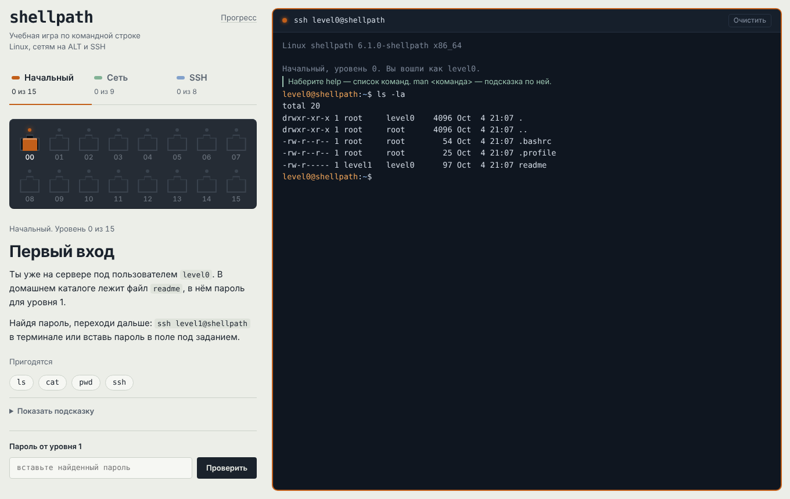

# shellpath

Учебная игра по командной строке Linux с терминалом прямо в браузере. Каждый уровень — маленькая задача: найти пароль, починить сеть, войти на сервер по ключу. Ничего не нужно устанавливать, ничего нельзя сломать по-настоящему.

Игра сделана для студентов, которые учатся на сетевых администраторов, и ориентирована на **ALT Linux**: сеть настраивается через etcnet, как на занятиях и на демоэкзамене.



## Что внутри

| Блок | Уровней | Чему учит |
|---|---|---|
| Начальный | 15 | `ls`, `cat`, `find`, `grep`, `sort \| uniq`, `strings`, `base64`, `tr`, права и `chmod`, `grep '^…'`, `nano`, `>>` |
| Сеть | 9 | `ip a/link/route`, маски и префиксы, шлюз, etcnet (`/etc/net/ifaces`), DNS, `hostnamectl`, `ip_forward`, NAT через `iptables`, GRE-туннель |
| SSH | 8 | вход по ключу, права на ключ, нестандартный порт, `ssh-keygen` и `authorized_keys`, `~/.ssh/config`, `known_hosts`, `ProxyJump`, `sshd -t` |

Каждый блок опирается только на то, что объяснено раньше. Это проверяют тесты: у каждого уровня есть эталонное решение, и CI прогоняет их все.

В блоке «Сеть» работает настоящая модель сети из шести машин: пакеты идут по таблицам маршрутов, через NAT и GRE-туннель. `reboot` стирает всё, что не записано в файлы, поэтому научиться можно и «как сделать», и «как сделать, чтобы пережило перезагрузку».

## Как играть

- Читайте задание слева, вводите команды в терминал справа.
- `help` — список команд, `man <команда>` — справка на русском, ↑/↓ — история.
- Tab дополняет команды, файлы и аргументы: `ip li` → `ip link`, `systemctl restart net` → `network`, `iptables -t n` → `nat`, имена интерфейсов и хосты из `known_hosts`. Если вариантов несколько, Tab покажет список.
- На телефоне под терминалом есть кнопки Tab, ↑, ↓, Ctrl+C и Ctrl+L.
- В «Начальном» блоке найденный пароль вводится командой `ssh levelN@shellpath` или в поле под заданием.
- В «Сети» уровень проверяет команда `labcheck`.
- В SSH уровень засчитывается, когда вы вошли под следующим пользователем.
- Прогресс сохраняется в браузере. Чтобы перенести его на другой компьютер: «Прогресс» → «Скопировать код прогресса».

> Пароли и решения лежат в исходном коде — это учебная игра, а не соревнование. Подсматривать можно, но смысла мало.

## Запуск на своём компьютере

Есть три способа. Выберите любой.

### Способ 1. Один файл, который открывается двойным щелчком

Игру можно собрать в один файл `shellpath.html`. Его достаточно открыть в браузере: сервер, интернет и Node.js для этого не нужны. Удобно, чтобы раздать группе на флешке.

Собрать файл нужно один раз на компьютере с Node.js (как его поставить — в способе 2, шаги 1–2):

```sh
npm run build
```

Файл появится в папке `dist`. Если репозиторий опубликован на GitHub Pages (см. ниже), тот же файл можно просто открыть по ссылке.

### Способ 2. Через Node.js (рекомендуется)

**Шаг 1. Установите Node.js версии 20 или новее.** Проверить, есть ли он уже: откройте терминал и введите `node --version`. Если видите `v20…` или выше — переходите к шагу 2.

- **ALT Linux** (Workstation, Server, Education):
  ```sh
  su -
  apt-get update
  apt-get install node npm git
  exit
  node --version
  ```
  Если `apt-get` не находит пакет `node`, посмотрите точное имя: `apt-cache search nodejs`.
- **Ubuntu, Debian, Mint**: в стандартных репозиториях бывает старая версия. Надёжнее так:
  ```sh
  sudo apt install curl git
  curl -fsSL https://deb.nodesource.com/setup_22.x | sudo -E bash -
  sudo apt install nodejs
  ```
- **Windows**: скачайте установщик «LTS» с [nodejs.org](https://nodejs.org/ru), запустите и жмите «Далее». После установки откройте **PowerShell** (Пуск → PowerShell).
- **macOS**: скачайте установщик с [nodejs.org](https://nodejs.org/ru) или, если стоит Homebrew, выполните `brew install node`.

**Шаг 2. Скачайте проект.**

С git:
```sh
git clone https://github.com/<ваш-аккаунт>/shellpath.git
cd shellpath
```

Без git: на странице репозитория нажмите зелёную кнопку **Code → Download ZIP**, распакуйте архив и перейдите в папку в терминале. Например:

- Linux / macOS: `cd ~/Загрузки/shellpath-main` (или `cd ~/Downloads/shellpath-main`)
- Windows (PowerShell): `cd $HOME\Downloads\shellpath-main`

Проверить, что вы в нужной папке: команда `ls` (в Windows тоже работает) должна показать `index.html`, `package.json`, `src`.

**Шаг 3. Ничего не устанавливайте через npm.** У проекта нет зависимостей, `npm install` не нужен.

**Шаг 4. Запустите.**
```sh
npm start
```
Появится строка `shellpath запущен: http://localhost:8080`.

**Шаг 5. Откройте в браузере** адрес <http://localhost:8080>.

Остановить сервер: в терминале нажмите **Ctrl+C**. Если порт 8080 занят, запустите на другом: `npm start -- 8081` и откройте <http://localhost:8081>.

### Способ 3. Через Python (если Node.js ставить не хочется)

Python уже есть почти в любом Linux, в том числе в ALT.

```sh
cd путь/к/shellpath
python3 -m http.server 8080
```
Откройте <http://localhost:8080>. В Windows вместо `python3` обычно пишут `py`.

> Почему нельзя просто открыть `index.html` двойным щелчком? Исходники разбиты на модули, а браузеры не загружают модули со страницы, открытой как файл. Поэтому нужен маленький локальный сервер (способы 2 и 3) или собранный файл (способ 1).

### Частые проблемы

| Что видите | Что сделать |
|---|---|
| `npm: command not found` / «npm не является командой» | Node.js не установлен или терминал открыт до установки. Закройте и откройте терминал заново. |
| `node --version` показывает v16 или v18 | Установите версию 20+ по инструкции выше. Для запуска хватит и 18, для тестов нужна 20+. |
| `Порт 8080 занят` | `npm start -- 8081` |
| Страница пустая, в консоли браузера ошибка про модули | Вы открыли `index.html` как файл. Запустите сервер или соберите `dist/shellpath.html`. |
| Шрифты выглядят иначе | Шрифты грузятся из интернета. Без сети подставятся системные, на работу это не влияет. |

## Для разработчиков

```sh
npm test         # все тесты, включая эталонные решения всех уровней
npm run build    # dist/shellpath.html — один файл без зависимостей
npm start        # локальный сервер на http://localhost:8080
```

- [docs/ARCHITECTURE.md](docs/ARCHITECTURE.md) — как устроен код
- [docs/ADDING_LEVELS.md](docs/ADDING_LEVELS.md) — как добавить уровень
- [docs/LIMITATIONS.md](docs/LIMITATIONS.md) — чем эмулятор отличается от настоящего Linux
- [docs/DESIGN.md](docs/DESIGN.md) — визуальная система и спецификация интерфейса
- [CONTRIBUTING.md](CONTRIBUTING.md) — как предложить изменения

### Публикация на GitHub Pages

В репозитории уже есть workflow `.github/workflows/pages.yml`. Включите Pages: **Settings → Pages → Source: GitHub Actions**. После каждого пуша в `main` тесты прогонятся, а игра опубликуется по адресу `https://<аккаунт>.github.io/shellpath/`.

## Благодарности

Формат игры вдохновлён [OverTheWire: Bandit](https://overthewire.org/wargames/bandit/). Задания, тексты, данные и код shellpath написаны заново.

## Лицензия

Код — [MIT](LICENSE). Тексты уровней и документация — [CC BY-SA 4.0](LICENSE-CONTENT.md): можно использовать на занятиях и переделывать, указав источник.
