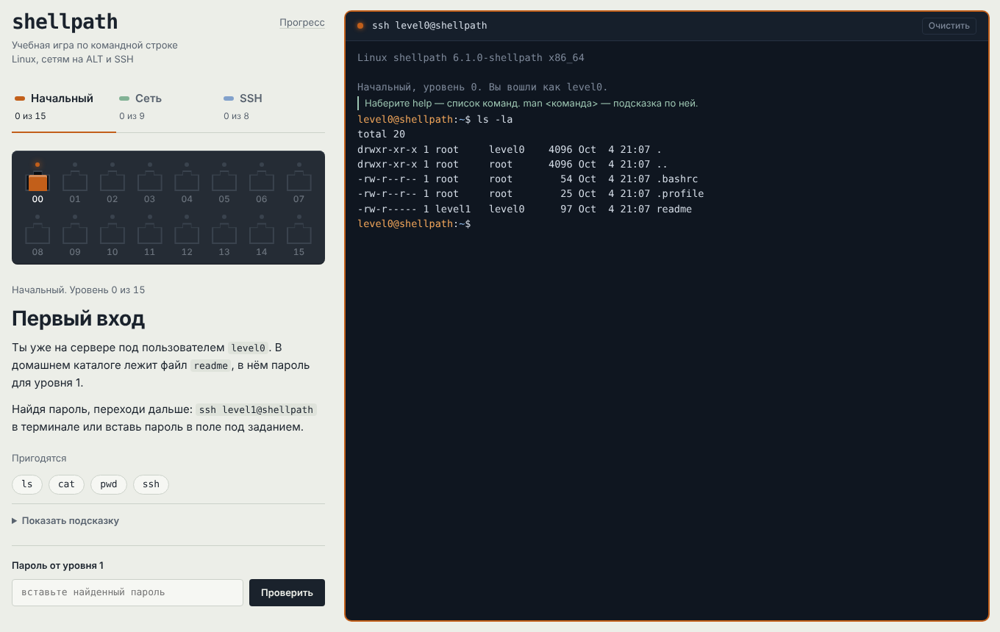
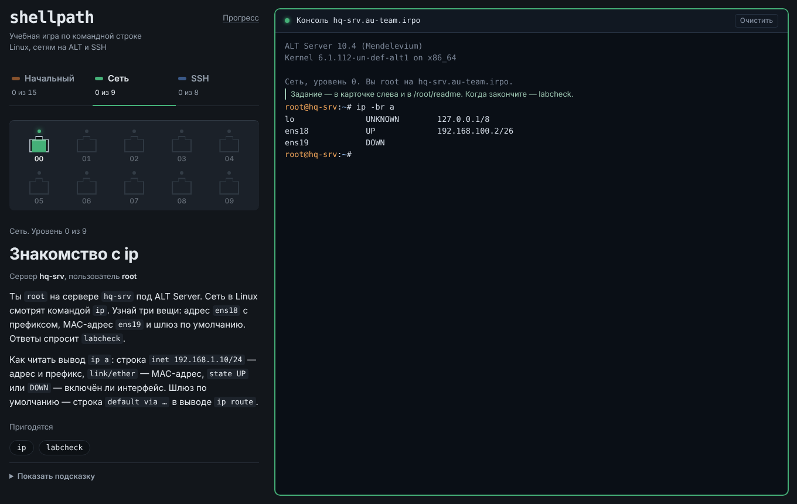

# Спецификация интерфейса: экран игры

## Обзор

Один экран: слева — задание и выбор уровня, справа — терминал. Игрок читает задание, работает в терминале и возвращается к заданию за подсказкой. Терминал — главный инструмент, поэтому он занимает всю высоту и всю оставшуюся ширину.

Визуальная идея — учебная лаборатория сетевика. Уровни выбираются на **патч-панели**: каждый уровень — гнездо RJ-45 с индикатором, у текущего вставлен патч-корд. Цвет блока взят из маркировки витой пары T568B: оранжевая пара — «Начальный», зелёная — «Сеть», синяя — SSH. Это единственный яркий элемент; остальное спокойное: бумажный фон, тёмный текст, никаких карточек с тенями.

## Раскладка

| Область | Поведение |
|---|---|
| `.app` | Сетка из двух колонок: `minmax(340px, 430px)` и остаток. Высота — весь экран. Поля `--s4` сверху и снизу, по бокам `max(16px, safe-area)`. Промежуток `--s5`. |
| `.side` | Колонка с собственной прокруткой. Порядок сверху вниз: шапка, вкладки блоков, патч-панель, задание, поле пароля или пояснение. Промежутки `--s5`. Всё выровнено по левому краю. |
| `.term` | Занимает всю высоту. Внутри: строка заголовка, журнал, строка ввода. Поверх журнала открывается редактор nano. |

Текст задания ограничен 62 знаками в строке: длинные строки на широком экране читаются хуже.

## Токены

### Цвет

| Токен | Светлая | Тёмная | Где |
|---|---|---|---|
| `--paper` | `#eceee8` | `#12161b` | Фон страницы |
| `--ink` | `#1a222c` | `#e2e7ec` | Основной текст, кнопка «Проверить» |
| `--muted` | `#59636f` | `#96a1ae` | Подписи, неактивные вкладки |
| `--rule` | `#cbd1c9` | `#262d36` | Разделители, рамки полей |
| `--tint` | `#dfe3db` | `#1d232b` | Фон `код` и блоков кода |
| `--field` | `#f6f7f3` | `#0d1115` | Поля ввода, кнопки команд |
| `--hw` | `#252c35` | `#1b2129` | Корпус патч-панели |
| `--hw-edge` | `#3a434e` | `#2f3842` | Ободок гнезда, заглушка |
| `--jack` | `#0a0e13` | `#05080b` | Глубина гнезда |
| `--c-basic` | `#c25f1a` | `#e8853c` | Блок «Начальный» (оранжевая пара) |
| `--c-net` | `#2b8150` | `#45b078` | Блок «Сеть» (зелёная пара) |
| `--c-ssh` | `#2c63b3` | `#5b8fe0` | Блок SSH (синяя пара) |
| `--block` | один из трёх выше | | Задаётся атрибутом `data-block` на элементе |
| `--ok` / `--bad` | `#24704b` / `#a83a2b` | `#5cc493` / `#f0907f` | Результат проверки пароля |
| `--term-*` | одинаковы | | Терминал всегда тёмный: так его читают и в реальной работе |

Терминал не следует теме страницы: и в светлой, и в тёмной он `--term-bg #0f1620`. Пользовательская часть приглашения — `--term-user`, путь — `--term-path`, ошибки — `--term-err`, подсказки игры — `--term-note`.

### Шрифты

| Токен | Значение | Где |
|---|---|---|
| `--f-ui` | Golos Text 400/500/600/700 | Весь интерфейс. Шрифт русской разработки с полной кириллицей. |
| `--f-mono` | JetBrains Mono 400/600 | Терминал, `код`, логотип, кнопки команд |

Шкала 1.25 от 15 px:

| Токен | Размер | Где |
|---|---|---|
| `--t-xs` | 12 px | Номера портов, счётчики вкладок |
| `--t-s` | 13 px | Подписи, служебный текст |
| `--t-m` | 15 px / 1.6 | Основной текст |
| `--t-l` | 18 px | — (резерв) |
| `--t-xl` | 22 px | Заголовок задания на телефоне |
| `--t-2xl` | 28 px / 1.15, 700 | Заголовок задания, логотип |

Подписи пишутся с заглавной буквы в начале предложения, без капса.

### Отступы и радиусы

`--s1` 4 · `--s2` 8 · `--s3` 12 · `--s4` 16 · `--s5` 24 · `--s6` 32 px. Радиусы: `--r-s` 4 px (поля, код, кнопки), `--r-m` 8 px (патч-панель, терминал, всплывающее окно). Кнопки команд — полностью скруглённые: это «жетоны», а не кнопки действия.

## Компоненты

| Компонент | Вариант | Данные | Поведение |
|---|---|---|---|
| Вкладка блока `.tab` | обычная / выбрана (`aria-selected`) | название, «N из M» | Переключает, какой блок показан на патч-панели. Текущий уровень не меняет. Цветная полоска — цвет пары блока. |
| Порт `.port` | `is-done`, `is-current`, `is-open`, `is-locked` | номер, название уровня | Клик — вход на уровень. В блоке «Сеть» лаборатория собирается заново. |
| Задание `.mission` | — | блок, номер, название, сервер (для «Сети» и SSH), Markdown-текст, команды, подсказка | Кнопка команды выполняет `man <команда>` в терминале. Подсказка свёрнута в `
`. |
| Поле пароля `.pass` | только «Начальный», кроме финала | — | Верный пароль — вход на следующий уровень и зелёное сообщение. |
| Пояснение `.how` | «Сеть» и SSH | — | Объясняет, как засчитывается уровень. |
| Всплывающее окно «Прогресс» | — | код `SP1.…` | Скопировать код, загрузить код, сбросить (в два нажатия). |
| Терминал `.term` | подключён / не подключён | заголовок, глубина сессий | Индикатор связи в цвете блока; без сессии — красный. |
| Редактор `.editor` | обычный / вопрос о сохранении | имя файла, текст | Ctrl+O/Ctrl+S — записать, Ctrl+X — выйти, при изменениях спрашивает Y/N. На телефоне — кнопки внизу. |

## Состояния портов

| Состояние | Индикатор | Гнездо | Номер |
|---|---|---|---|
| `is-done` — пройден | горит цветом блока с ореолом | пустое | обычный |
| `is-current` — вы здесь | горит с ореолом | вставлен патч-корд цвета блока | белый |
| `is-open` — открыт, ещё не пройден | мигает раз в 1,6 с | пустое | обычный |
| `is-locked` — закрыт | погашен | закрыто заглушкой | 50 % прозрачности, курсор «запрещено» |
| наведение (не закрыт) | — | ободок светлеет | — |
| фокус с клавиатуры | — | рамка 2 px цвета блока | — |

## Прочие состояния

| Элемент | Состояние | Поведение |
|---|---|---|
| Строка ввода | команда выполняется | приглашение скрыто, ввод игнорируется |
| Строка ввода | вопрос (пароль, yes/no) | приглашение заменяется текстом вопроса; для пароля поле становится `type=password` |
| Поле пароля | пусто / неверно / верно | «Вставьте пароль» / объяснение про регистр / «Верно. Вы на уровне N» |
| Кнопка «Сбросить прогресс» | первое нажатие | текст «Точно сбросить?», через 3,5 с возвращается |
| Экспорт прогресса | буфер обмена недоступен | показывается поле с кодом, текст выделен |

## Адаптивность

| Ширина | Что меняется |
|---|---|
| > 900 px | Две колонки, левая прокручивается сама |
| ≤ 900 px | Одна колонка: сначала задание, под ним терминал высотой 74 % экрана (не меньше 440 px). Страница прокручивается целиком. |
| ≤ 420 px | Заголовок задания 22 px |

Патч-панель всегда заполняет ряды целиком: до 9 портов — один ряд, больше — два одинаковых (16 → 8 + 8, 10 → 5 + 5).

## Крайние случаи

- **Длинные слова в задании** (пути, команды) переносятся внутри `код` (`overflow-wrap: anywhere`), страница не уезжает вбок.
- **Длинный вывод в терминале** — журнал хранит последние 1500 строк.
- **Двоичные данные** в выводе (`cat data.txt` на уровне 9) — управляющие символы заменяются символом замены U+FFFD.
- **Нет шрифтов** (офлайн) — подставляются системные, раскладка не ломается.
- **Нет localStorage** (приватный режим) — игра работает, прогресс живёт до закрытия вкладки.
- **Узкий терминал** — длинные строки переносятся, а не прокручиваются вбок.

## Движение

| Элемент | Триггер | Анимация | Длительность |
|---|---|---|---|
| Индикатор открытого порта | постоянно | мигание, два шага | 1,6 с |

Других анимаций нет. При `prefers-reduced-motion: reduce` индикатор не мигает, а горит вполсилы.

## Доступность

- **Порядок фокуса**: «Прогресс» → вкладки блоков → порты слева направо → кнопки команд → подсказка → поле пароля → терминал.
- **Роли**: вкладки — `role=tab` с `aria-selected`; текущий порт — `aria-current="step"`; закрытые порты — `aria-disabled`; у каждого порта `aria-label` с номером, названием и состоянием.
- **Журнал терминала** — `role=log`, `aria-live=polite`: экранный диктор читает новый вывод.
- **Задание** — `aria-live=polite`: при смене уровня читается новый текст.
- **Строка ввода** — `aria-label` «Командная строка»; во время вопроса — текст вопроса.
- **Клавиатура**: Enter — выполнить, Tab — дополнить, ↑/↓ — история, Ctrl+C — прервать, Ctrl+L — очистить, Esc закрывает «Прогресс».
- **Контраст**: основной текст на бумаге — не ниже 12:1, приглушённый — не ниже 5:1, текст терминала — не ниже 12:1.
